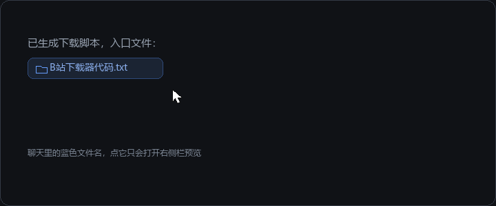

# dsh-reveal-in-explorer

[](https://github.com/Ghdhdhhake/dsh-reveal-in-explorer/actions/workflows/ci.yml)
[](https://github.com/Ghdhdhhake/dsh-reveal-in-explorer/releases)
[](LICENSE)
[](https://github.com/deepseek-ai/deepseek-harness)

> Hover a blue file reference in the DeepSeek Harness chat to reveal that file in your operating system's file manager.

English · [中文](README.md)



Clicking a file reference keeps the native behaviour (open it in the right Sidebar). This plugin only adds a **hover** affordance: one click opens Explorer / Finder / the Linux file manager with the file selected.

**Tested on DSH `0.2.1-rc.2`** (Windows, DeepSeek Harness Desktop): hover, chip, and the Explorer hand-off all work. For other versions see the `engines.dsh` range under [Compatibility](#compatibility).

## Features

- **Hover to reveal** — after a 160 ms dwell the overlay shows “📂 Reveal in File Explorer” to the **right** of the reference, falling back to below, then above, and always clamped inside the viewport.
- **Native click untouched** — the plugin never intercepts the existing preview action.
- **Platform-aware** — the Host's `open-in-app` / `native-command` decides the target: `explorer.exe /select,` on Windows, `open -R` on macOS, the parent directory on Linux.
- **Workspace-relative paths** — `docs/a.md` is resolved against the active Session's `cwd`.
- **Host-verified** — paths go through `remote.session.openWorkspacePath({ action: 'reveal' })`; the plugin spawns no process and reads no file content.
- **Failures stay visible** — when the Host refuses (missing path, no permission, no desktop file manager) the chip **stays open** and shows the Host's reason on a second line, and one `console.warn` line records the path plus the reason for issue reports.
- **Bilingual UI**, theme-token styling, keyboard reachable (`focusin` also arms it, `Esc` closes).

## Covered reference types

| Surface | DOM shape |
| --- | --- |
| Inline-code file reference in an assistant reply (the blue filename) | `code > button[title]` |
| Markdown link that points at a path | `button.fileLink[title]` |
| Composer / user-message file chip | `[data-ref-chip="file"][title]` |
| Delivered-file card | `[data-presented-file] button[title]` |
| Fallback for other chat controls with a path tooltip | `[data-chat-flow] button[title]` / `a[title]` |

The fallback only accepts tooltips that look like paths (a separator, or a bare `name.ext`), so action labels such as `Copy` or `Open in sidebar` are ignored.

## Install

```sh
dsh plugin --profile web add dsh-reveal-in-explorer
```

Before the package is published to NPM, install straight from this repository:

```sh
dsh plugin --profile web add github:Ghdhdhhake/dsh-reveal-in-explorer
```

Or from a local directory:

```sh
dsh plugin --profile web add /path/to/dsh-reveal-in-explorer
```

Swap `web` for your own profile name (for example `desktop`). Refresh the page afterwards; Client changes hot-reload, no restart needed.

### Manual mount (offline)

If pnpm cannot reach the registry, install the directory as a `link:` dependency and let the profile's bundle stack mount it:

1. In the profile's `package.json`:

   ```json
   "dependencies": { "dsh-reveal-in-explorer": "link:/path/to/dsh-reveal-in-explorer" }
   ```

2. In `pnpm-lock.yaml` under `importers['.']`:

   ```yaml
   dsh-reveal-in-explorer:
     specifier: link:/path/to/dsh-reveal-in-explorer
     version: link:/path/to/dsh-reveal-in-explorer
   ```

3. Add `dsh-reveal-in-explorer` to `dsh.profile.bundles`, then:

   ```sh
   pnpm install --offline --ignore-scripts --config.trust-lockfile=true
   ```

## Uninstall

Disable and remove `dsh-reveal-in-explorer` under **Settings → Plugins**, or delete it from the profile's `dependencies` / `dsh.profile.bundles` and reinstall dependencies.

## Development

```sh
node scripts/build.mjs   # src/ → lib/index.js and lib/client.js
node scripts/check.mjs   # manifest, resources, selector contract, shipped files
npm test                 # unit tests (Node's built-in runner, no dependencies)
```

Or run everything with `npm run verify`. All of it is dependency-free and offline. `lib/` is committed, so installing the bundle never runs a build script.

`npm test` lists the four test files explicitly (Node 20 does not expand globs for `--test`, and cmd.exe does not either). `scripts/check.mjs` verifies that every `*.test.mjs` under `test/` is listed, so a new test file that nobody registered fails the build instead of silently never running.

### Test coverage

| File | Covers |
| --- | --- |
| `test/paths.test.mjs` | **Path joining**, the cross-platform core: Windows drive/UNC, macOS/Linux separators, absolute-wins, empty workspace, CJK and spaces |
| `test/selectors.test.mjs` | **Selector contract**: every `SELECTORS` entry still resolves against `test/fixtures/chat-transcript.html`, so a DSH markup change fails CI |
| `test/behaviour.test.mjs` | Registration contract, `inject`, the exact Host request, failure reasons, the `console.warn` line, chip placement |
| `test/render.test.mjs` | Popup states: idle/busy/done/error (including the reason line), theme tokens, viewport clamping |

`test/fixtures/chat-transcript.html` is a **structural snapshot** checked against the DSH 0.2.1-rc.2 client bundles: inline-code mentions, Markdown file links, `@` chips, delivered-file cards, and decoys (`Copy`, `Retry`) that must stay inert. When the Host changes its markup, update the fixture first — the tests then name the selector that broke.

### Layout

```
src/index.js           Host entry (empty; gives the bundle a Host row)
src/client/index.js    Client implementation (CommonJS factory source + SELECTORS table)
lib/index.js           Built Host entry
lib/client.js          Built client bundle wrapped in the __ModuleLoader__ envelope
cordis.patch.yml       Bundle patch inserting the reveal-in-explorer row
dsh.plugin.json        Plugin manifest (name / entry / client.platform)
locale/{en,zh}.json    Marketplace title and description
icon.svg               Plugin icon
docs/demo.gif          README demo loop (regenerate with docs/render-demo.py)
test/                  Unit tests, DOM fixture, minimal selector engine
scripts/               Build and static checks
.github/workflows/ci.yml  CI: Node 20/22/24 × ubuntu/windows
```

## Compatibility

- `engines.dsh`: **`>=0.2.0-rc.1 <0.3.0`**, declared in `package.json` so DSH rejects an incompatible install instead of loading it and crashing later.
- **Verified on** `0.2.1-rc.2` (Windows, DeepSeek Harness Desktop). CI builds and runs the full suite on Ubuntu and Windows across Node 20/22/24.
- Needs the Host's `remote.session` (`@deepseek-ai/dsh-api-remotes`) and the `shell.overlay` slot. When either is missing the plugin degrades to a no-op instead of breaking the page.
- On a host without a desktop file manager (a plain server, for example) the chip still appears, but clicking shows the failure reason on its second line rather than pretending success.

## Known limitations

- Reference detection follows the DOM the Host renders today; the selectors live in one `SELECTORS` table, so a markup change means editing that table and the fixture.
- The overlay is positioned from the reference's bounding box and closes when the reference scrolls out of view.
- Linux has no common "select this file" protocol, so the Host opens the containing directory instead (that is DSH `native-command` behaviour).

## License

MIT
