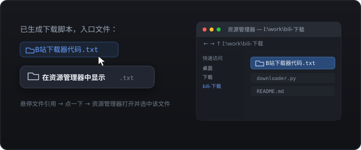

# dsh-reveal-in-explorer

> 在 DeepSeek Harness 聊天里悬停蓝色文件引用，一键用系统文件管理器定位该文件。

[English](README.en.md) · 中文



默认点击文件引用仍然走 Harness 原生行为（在右侧栏预览），本插件只在**悬停**时多给一个入口：直接打开资源管理器 / Finder / Linux 文件管理器并选中该文件。

## 功能

- **悬停即出**：指针在文件引用上停留 160ms，浮层在引用下方弹出「📂 在资源管理器中显示」。
- **默认行为不变**：点击引用依旧在右侧栏预览，不劫持任何原生交互。
- **平台自适应**：由宿主 `open-in-app` / `native-command` 决定落点——Windows `explorer.exe /select,`，macOS `open -R`，Linux 打开所在目录。
- **相对路径补全**：`docs/a.md` 这类工作区相对路径会用当前会话的 `cwd` 补成绝对路径。
- **安全边界**：路径由宿主 `remote.session.openWorkspacePath({ action: 'reveal' })` 校验，插件本身不 spawn 进程、不读文件内容。
- **中英双语**、跟随宿主主题 token、键盘可达（`focusin` 同样触发，`Esc` 关闭）。

## 覆盖的引用类型

| 位置 | DOM 形态 |
| --- | --- |
| 助手回复中的内联代码文件引用（蓝色文件名） | `code > button[title]` |
| Markdown 链接形式的文件路径 | `button.fileLink[title]` |
| 输入框 / 用户消息中的文件 chip | `[data-ref-chip="file"][title]` |
| 交付文件卡片 | `[data-presented-file] button[title]` |
| 其它带路径 tooltip 的聊天内控件 | `[data-chat-flow] button[title]` / `a[title]` |

最后一条是兜底：tooltip 看起来像路径（含分隔符，或形如 `name.ext`）才认，`Copy`、`Open in sidebar` 这类动作文案会被排除。

## 安装

```sh
dsh plugin --profile <profile> add github:Ghdhdhhake/dsh-reveal-in-explorer
```

或从本地目录安装：

```sh
dsh plugin --profile <profile> add /path/to/dsh-reveal-in-explorer
```

安装后刷新页面即可；Client 改动热加载，无需重启。

### 手动挂载（离线环境）

本机网络策略可能拦下 pnpm 访问 registry。此时把目录以 `link:` 依赖装进 profile，再让 profile 的 bundle 栈挂载它：

1. profile 的 `package.json`：

   ```json
   "dependencies": { "dsh-reveal-in-explorer": "link:/path/to/dsh-reveal-in-explorer" }
   ```

2. `pnpm-lock.yaml` 的 `importers['.']` 下补：

   ```yaml
   dsh-reveal-in-explorer:
     specifier: link:/path/to/dsh-reveal-in-explorer
     version: link:/path/to/dsh-reveal-in-explorer
   ```

3. `dsh.profile.bundles` 追加 `dsh-reveal-in-explorer`，然后：

   ```sh
   pnpm install --offline --ignore-scripts --config.trust-lockfile=true
   ```

## 卸载

在 **设置 → 插件** 中停用并移除 `dsh-reveal-in-explorer`，或从 profile 的 `dependencies` / `dsh.profile.bundles` 删除后重新安装依赖。

## 开发

```sh
node scripts/build.mjs   # 由 src/ 生成 lib/index.js 与 lib/client.js
node scripts/check.mjs   # 清单、资源与产物一致性检查
node scripts/test.mjs    # 在 vm 沙箱里跑 client bundle 的行为测试
```

三个脚本零依赖、不联网，可直接在 Windows PowerShell 里运行。`lib/` 是提交进仓库的构建产物，安装时不会执行任何构建脚本。

### 目录

```
src/index.js           Host 入口（空实现，仅给 bundle 一个 Host 行）
src/client/index.js    Client 实现（CJS factory 源码）
lib/index.js           构建产物：Host 入口
lib/client.js          构建产物：带 __ModuleLoader__ 外壳的 client bundle
cordis.patch.yml       bundle 补丁：插入 reveal-in-explorer 行
dsh.plugin.json        插件清单（name / entry / client.platform）
locale/{en,zh}.json    插件市场展示用的标题与描述
icon.svg               插件图标
scripts/               构建、静态检查、行为测试
```

## 兼容性

- 需要 `dsh >= 0.2.0-rc.1 < 0.3.0`（`engines.dsh`），在 `0.2.1-rc.2` 上验证。
- 依赖宿主已装配的 `remote.session`（`@deepseek-ai/dsh-api-remotes`）与 `shell.overlay` 槽位。缺失时插件自动降级为无操作，不会让页面报错。
- 宿主没有桌面文件管理器（例如纯服务器部署）时，按钮会出现但点击返回失败原因，不会假装成功。

## 已知限制

- 文件引用的识别依赖宿主当前渲染出的 DOM 形态；宿主若改变引用结构，需要同步更新 `readPathTarget`。
- 浮层按引用元素的包围盒定位；引用被裁剪或滚出视口时浮层会关闭而不是跟随。

## License

MIT
